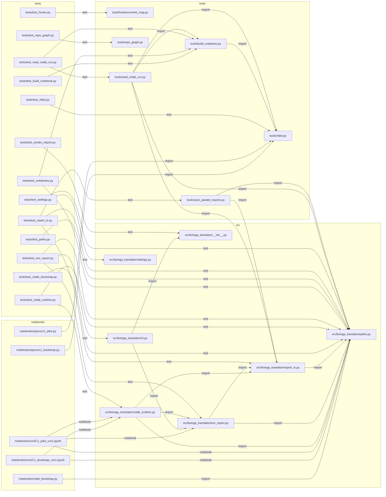

# Repo graph

Generated by `tools/repo_graph.py`. Do not edit by hand.

## Tree

- `.claude/`
  - `agents/`
    - `code-reviewer.md` — Reviews staged changes in boinga-translator before every commit. (19 lines)
    - `debugger.md` — Investigates failures in boinga-translator using the debug-protocol skill. (10 lines)
  - `skills/`
    - `atomic-commit/`
      - `SKILL.md` — How to stage and commit in boinga-translator. (43 lines)
    - `boinga-workflow/`
      - `SKILL.md` — The mandatory loop for every subchunk of the boinga-translator project. (37 lines)
    - `colab-handoff/`
      - `SKILL.md` — "How to put work on Colab in boinga-translator: write cells into the chunk's notebook spec and hand the whole notebook to the user. (77 lines)
    - `colab-verify/`
      - `SKILL.md` — Verify an executed Colab notebook the user put in colab_runs/. (50 lines)
    - `debug-protocol/`
      - `SKILL.md` — Structured debugging for boinga-translator. (47 lines)
    - `dialect-data-rules/`
      - `SKILL.md` — Rules for handling Chittagonian audio and transcripts in boinga-translator. (25 lines)
    - `repo-graph/`
      - `SKILL.md` — Keep and use the repo map of boinga-translator. (28 lines)
    - `vits-finetune/`
      - `SKILL.md` — Coqui-TTS VITS fine-tuning specifics for boinga-translator. (26 lines)
  - `settings.json` (29 lines)
- `.githooks/`
  - `commit-msg` — Commit-msg: enforce the atomic-commit message format. (8 lines)
  - `pre-commit` — Pre-commit: block binaries/large files, stale repo graph, ruff errors, failing tests. (8 lines)
- `docs/`
  - `DEBUG_LOG.md` — Debug log (47 lines)
  - `DECISIONS.md` — Decisions (128 lines)
  - `PROGRESS.md` — Progress (112 lines)
- `notebooks/`
  - `runs/`
    - `C1_bootstrap_run1.ipynb` — C1 run 1 — Colab bootstrap (266 lines)
    - `C1_pilot_run1.ipynb` — C1 run 1 — Pipeline pilot (373 lines)
  - `specs/`
    - `c1_bootstrap.py` — Spec: C1 bootstrap-only notebook on main (mount Drive, clone, install deps, record env). (12 lines)
    - `c1_pilot.py` — Spec: C1 pilot run proving the notebook pipeline (env report, Drive write, a form). (37 lines)
  - `colab_bootstrap.py` — Colab bootstrap cells: mount Drive, clone/pull the private repo, install deps, make folders. (131 lines)
- `reports/`
  - `colab_runs/`
    - `C1_pilot_run1.md` — Colab run C1 run 1 — Pipeline pilot (214 lines)
  - `notes/`
    - `C1.10-notes.json` (4 lines)
  - `env.json` (16 lines)
- `src/`
  - `boinga_translator/`
    - `__init__.py` — Chittagonian TTS proof of concept: fine-tuning a Bangla VITS model. (3 lines)
    - `cli.py` — Command-line entry point (`boinga`) for data prep, training and demo commands. (28 lines)
    - `colab_runtime.py` — Helpers called inside generated Colab cells: run header, cell markers, notes, file checks. (115 lines)
    - `env_report.py` — Record python, torch/CUDA, GPU, coqui-tts, numpy, git and disk info to reports/env.json. (100 lines)
    - `paths.py` — Single source of truth for paths: Drive + fast disk on Colab, ./local elsewhere. (133 lines)
    - `report_io.py` — Move Colab reports into the repo: print files between BEGIN/END markers, parse pasted output. (124 lines)
    - `settings.py` — Pinned facts: pretrained model ids/URLs, dataset file + sha256, seed and inference scales. (43 lines)
- `tests/`
  - `test_build_notebook.py` — Tests for tools/build_notebook.py: tiny spec -> .ipynb layout, determinism and --check. (133 lines)
  - `test_colab_bootstrap.py` — Tests for notebooks/colab_bootstrap.py: parses as Python, 4 cells, guards, no secrets in it. (60 lines)
  - `test_colab_runtime.py` — Tests for colab_runtime.py: run header, cell marker, notes, expect_files and play fallbacks. (150 lines)
  - `test_env_report.py` — Tests for env_report.py and `boinga env`: missing torch, fake GPU, JSON keys, CLI wiring. (117 lines)
  - `test_hooks.py` — Tests for tools/hooks/commit_msg.py: valid messages pass, bad ones fail with the right reason. (57 lines)
  - `test_nbkit.py` — Tests for tools/nbkit.py: md/code/form cell sources, metadata, validation and Notebook. (142 lines)
  - `test_notebooks.py` — Tests for the committed run notebooks: in sync with their specs; C1 bootstrap shape, no secrets. (31 lines)
  - `test_paths.py` — Tests for paths.py: env overrides, Colab/local defaults, run_dir and ensure_dirs. (102 lines)
  - `test_read_colab_run.py` — Tests for tools/read_colab_run.py: cell statuses, forms, binary stripping, trimming and the CLI. (313 lines)
  - `test_repo_graph.py` — Tests for tools/repo_graph.py: node kinds, edge types, stability and --check on a fake repo. (93 lines)
  - `test_report_io.py` — Tests for report_io.py and tools/save_pasted_reports.py: round trip, traversal, big-file skip. (160 lines)
  - `test_settings.py` — Tests for settings.py: pinned hash format, https URLs, both voices, seed and the coqui pin. (31 lines)
  - `test_smoke_import.py` — Smoke test: the package imports and exposes a version. (7 lines)
- `tools/`
  - `hooks/`
    - `commit_msg.py` — Commit-msg guard: enforce the atomic-commit message format (header, Chunk/What/Why/How verified). (80 lines)
    - `pre_commit.py` — Pre-commit guard: block binaries/large files, stale map/notebooks, ruff errors, failing tests. (92 lines)
  - `build_notebook.py` — Build a per-chunk Colab notebook from a spec (notebooks/specs/*.py) into notebooks/runs/. (175 lines)
  - `nbkit.py` — Notebook spec API (stdlib only): md / code / form cells and the Notebook a spec defines. (173 lines)
  - `read_colab_run.py` — Read an executed Colab notebook (colab_runs/*.ipynb) and check every cell against its spec. (331 lines)
  - `repo_graph.py` — Generate the repo map (docs/REPO_GRAPH.md + docs/repo_graph.json): file purposes and edges. (309 lines)
  - `save_pasted_reports.py` — Save BEGIN/END report blocks pasted from Colab into the repo (from a file or stdin). (35 lines)
- `CLAUDE.md` — boinga-translator — rules for Claude Code (48 lines)
- `README.md` — boinga-translator (35 lines)
- `pyproject.toml` (41 lines)

## Dependency graph

## Hotspots

1. `src/boinga_translator/paths.py` — 15 dependents (`notebooks/colab_bootstrap.py`, `notebooks/runs/C1_bootstrap_run1.ipynb`, `notebooks/runs/C1_pilot_run1.ipynb`, `src/boinga_translator/colab_runtime.py`, `src/boinga_translator/env_report.py`, `src/boinga_translator/report_io.py`, `tests/test_colab_bootstrap.py`, `tests/test_colab_runtime.py`, `tests/test_env_report.py`, `tests/test_notebooks.py`, `tests/test_paths.py`, `tests/test_report_io.py`, `tests/test_settings.py`, `tools/read_colab_run.py`, `tools/save_pasted_reports.py`)
2. `src/boinga_translator/report_io.py` — 5 dependents (`src/boinga_translator/colab_runtime.py`, `src/boinga_translator/env_report.py`, `tests/test_report_io.py`, `tools/read_colab_run.py`, `tools/save_pasted_reports.py`)
3. `tools/nbkit.py` — 5 dependents (`notebooks/specs/c1_bootstrap.py`, `notebooks/specs/c1_pilot.py`, `tests/test_nbkit.py`, `tools/build_notebook.py`, `tools/read_colab_run.py`)
4. `src/boinga_translator/env_report.py` — 4 dependents (`notebooks/runs/C1_pilot_run1.ipynb`, `src/boinga_translator/cli.py`, `src/boinga_translator/colab_runtime.py`, `tests/test_env_report.py`)
5. `tools/build_notebook.py` — 4 dependents (`tests/test_build_notebook.py`, `tests/test_notebooks.py`, `tests/test_read_colab_run.py`, `tools/read_colab_run.py`)

## Changed since HEAD

No files added or removed.
