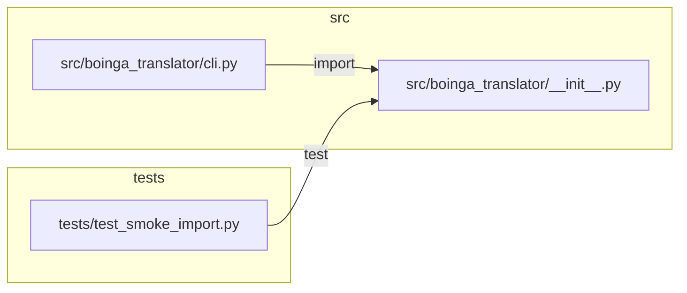

# Repo graph

Generated by `tools/repo_graph.py`. Do not edit by hand.

## Tree

- `.claude/`
  - `agents/`
    - `code-reviewer.md` — Reviews staged changes in boinga-translator before every commit. (19 lines)
    - `debugger.md` — Investigates failures in boinga-translator using the debug-protocol skill. (10 lines)
  - `skills/`
    - `atomic-commit/`
      - `SKILL.md` — How to stage and commit in boinga-translator. (43 lines)
    - `boinga-workflow/`
      - `SKILL.md` — The mandatory loop for every subchunk of the boinga-translator project. (37 lines)
    - `colab-handoff/`
      - `SKILL.md` — How to hand work to Google Colab and take results back. (29 lines)
    - `debug-protocol/`
      - `SKILL.md` — Structured debugging for boinga-translator. (46 lines)
    - `dialect-data-rules/`
      - `SKILL.md` — Rules for handling Chittagonian audio and transcripts in boinga-translator. (25 lines)
    - `repo-graph/`
      - `SKILL.md` — Keep and use the repo map of boinga-translator. (28 lines)
    - `vits-finetune/`
      - `SKILL.md` — Coqui-TTS VITS fine-tuning specifics for boinga-translator. (26 lines)
- `src/`
  - `boinga_translator/`
    - `__init__.py` — Chittagonian TTS proof of concept: fine-tuning a Bangla VITS model. (3 lines)
    - `cli.py` — Command-line entry point (`boinga`) for data prep, training and demo commands. (25 lines)
- `tests/`
  - `test_smoke_import.py` — Smoke test: the package imports and exposes a version. (7 lines)
- `tools/`
  - `repo_graph.py` — Generate the repo map (docs/REPO_GRAPH.md + docs/repo_graph.json): file purposes and edges. (309 lines)
- `CLAUDE.md` — boinga-translator — rules for Claude Code (48 lines)
- `README.md` — boinga-translator (10 lines)
- `pyproject.toml` (34 lines)

## Dependency graph

## Hotspots

1. `src/boinga_translator/__init__.py` — 2 dependents (`src/boinga_translator/cli.py`, `tests/test_smoke_import.py`)

## Changed since HEAD

(no docs/repo_graph.json in HEAD yet)
