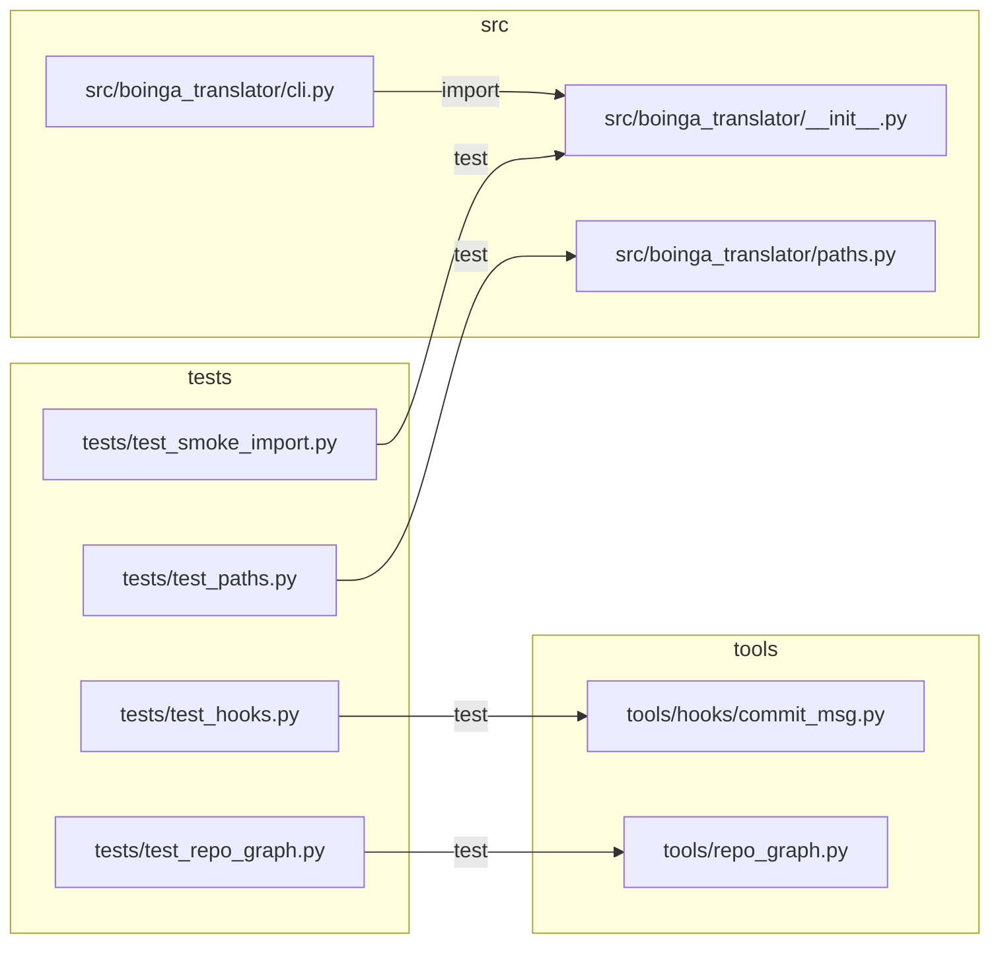

# Repo graph

Generated by `tools/repo_graph.py`. Do not edit by hand.

## Tree

- `.claude/`
  - `agents/`
    - `code-reviewer.md` — Reviews staged changes in boinga-translator before every commit. (19 lines)
    - `debugger.md` — Investigates failures in boinga-translator using the debug-protocol skill. (10 lines)
  - `skills/`
    - `atomic-commit/`
      - `SKILL.md` — How to stage and commit in boinga-translator. (43 lines)
    - `boinga-workflow/`
      - `SKILL.md` — The mandatory loop for every subchunk of the boinga-translator project. (37 lines)
    - `colab-handoff/`
      - `SKILL.md` — How to hand work to Google Colab and take results back. (29 lines)
    - `debug-protocol/`
      - `SKILL.md` — Structured debugging for boinga-translator. (46 lines)
    - `dialect-data-rules/`
      - `SKILL.md` — Rules for handling Chittagonian audio and transcripts in boinga-translator. (25 lines)
    - `repo-graph/`
      - `SKILL.md` — Keep and use the repo map of boinga-translator. (28 lines)
    - `vits-finetune/`
      - `SKILL.md` — Coqui-TTS VITS fine-tuning specifics for boinga-translator. (26 lines)
  - `settings.json` (29 lines)
- `.githooks/`
  - `commit-msg` — Commit-msg: enforce the atomic-commit message format. (8 lines)
  - `pre-commit` — Pre-commit: block binaries/large files, stale repo graph, ruff errors, failing tests. (8 lines)
- `docs/`
  - `DEBUG_LOG.md` — Debug log (19 lines)
  - `DECISIONS.md` — Decisions (47 lines)
  - `PROGRESS.md` — Progress (65 lines)
- `src/`
  - `boinga_translator/`
    - `__init__.py` — Chittagonian TTS proof of concept: fine-tuning a Bangla VITS model. (3 lines)
    - `cli.py` — Command-line entry point (`boinga`) for data prep, training and demo commands. (25 lines)
    - `paths.py` — Single source of truth for paths: Drive + fast disk on Colab, ./local elsewhere. (133 lines)
- `tests/`
  - `test_hooks.py` — Tests for tools/hooks/commit_msg.py: valid messages pass, bad ones fail with the right reason. (57 lines)
  - `test_paths.py` — Tests for paths.py: env overrides, Colab/local defaults, run_dir and ensure_dirs. (102 lines)
  - `test_repo_graph.py` — Tests for tools/repo_graph.py: node kinds, edge types, stability and --check on a fake repo. (93 lines)
  - `test_smoke_import.py` — Smoke test: the package imports and exposes a version. (7 lines)
- `tools/`
  - `hooks/`
    - `commit_msg.py` — Commit-msg guard: enforce the atomic-commit message format (header, Chunk/What/Why/How verified). (80 lines)
    - `pre_commit.py` — Pre-commit guard: block binaries/large files, stale repo graph, ruff errors and failing tests. (89 lines)
  - `repo_graph.py` — Generate the repo map (docs/REPO_GRAPH.md + docs/repo_graph.json): file purposes and edges. (309 lines)
- `CLAUDE.md` — boinga-translator — rules for Claude Code (48 lines)
- `README.md` — boinga-translator (21 lines)
- `pyproject.toml` (35 lines)

## Dependency graph

## Hotspots

1. `src/boinga_translator/__init__.py` — 2 dependents (`src/boinga_translator/cli.py`, `tests/test_smoke_import.py`)
2. `src/boinga_translator/paths.py` — 1 dependent (`tests/test_paths.py`)
3. `tools/hooks/commit_msg.py` — 1 dependent (`tests/test_hooks.py`)
4. `tools/repo_graph.py` — 1 dependent (`tests/test_repo_graph.py`)

## Changed since HEAD

- added: `src/boinga_translator/paths.py`
- added: `tests/test_paths.py`
